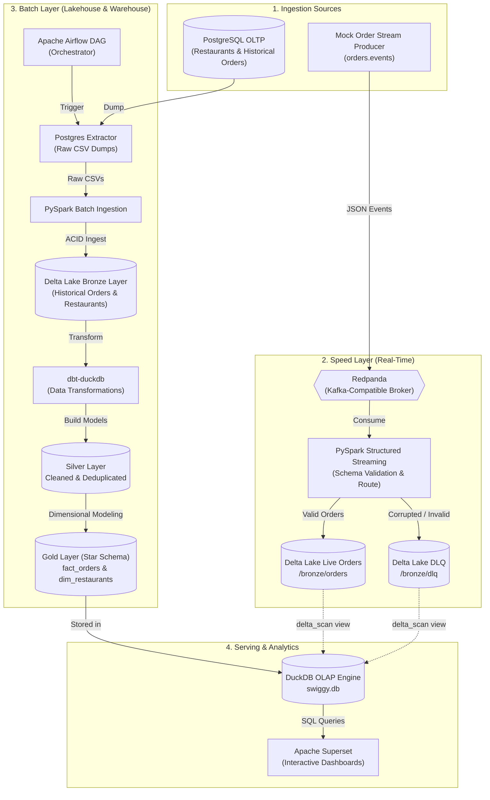

# Swiggy Data Engineering Platform (Lambda Architecture)

An end-to-end, production-grade Data Engineering platform simulating real-time order processing, driver tracking, and business analytics for a food delivery service (inspired by Swiggy). 

This platform implements a hybrid **Lambda Architecture** (combining a real-time **Speed Layer** and an ACID **Batch Layer**) engineered to run within a strict **8GB RAM budget** on a single workstation using Docker.

---

## Architecture Overview



---

## Tech Stack & Design Rationale

| Layer | Technology | Why This Choice? |
| :--- | :--- | :--- |
| **Message Broker** | **Redpanda v23.3** | C++ Kafka-compatible engine. Requires **no JVM or Zookeeper/KRaft overhead**, consuming only ~400MB RAM compared to standard Kafka. |
| **Stream & Batch Compute**| **Apache Spark 3.5 (PySpark)** | Scalable distributed processing engine with **Spark Structured Streaming** for micro-batch validation and **Delta Lake integration**. |
| **Storage & Lakehouse** | **Delta Lake 3.0** | Parquet-backed ACID transaction storage with schema enforcement, time-travel, and partitioning. |
| **Data Transformation** | **dbt (data build tool)** | SQL-first transformation workflow testing, versioning, and building Silver and Gold Star Schema layers. |
| **Analytical OLAP Engine**| **DuckDB 1.1** | Embedded columnar OLAP database. Queries Parquet and Delta tables directly with zero network overhead, replacing heavyweight Trino/ClickHouse clusters. |
| **Orchestration** | **Apache Airflow 2.11** | Schedules, retries, and coordinates Postgres extraction, PySpark Bronze ingestion, and dbt transformations. |
| **Visualization** | **Apache Superset 3.1** | Modern BI platform powering real-time streaming charts and batch analytics dashboards. |
| **Relational OLTP** | **PostgreSQL 15** | Primary operational database for customer profiles, menus, and historical receipts. |

---

## Data Modeling & Architecture

### 1. The Medallion Architecture (Lakehouse)
* **Bronze (Raw / Landed Data):**
  * Raw orders and restaurants stored in Delta Lake format (`data/delta_lake/bronze/`).
  * Direct stream landing with audit metadata (`ingested_at`, partition by `status`).
* **Silver (Cleaned & Conformed):**
  * Typecasting, filtering test transactions, standardized currency/timestamps (`silver_orders`, `silver_restaurants`).
* **Gold (Business & Reporting Layer):**
  * Dimensional Star Schema optimized for BI queries:
    * `fact_orders`: Transaction metrics (`total_amount`, item counts, delivery latency, timestamps).
    * `dim_restaurants`: Restaurant metadata (cuisine, rating, city, active status).

### 2. Real-Time Data Quality & Dead-Letter Queue (DLQ)
In high-throughput food delivery streams, malformed payloads (missing order IDs, negative price tags, unregistered event types) can pollute analytics.
* The streaming producer intentionally injects erroneous payloads into 20% of orders.
* PySpark Structured Streaming evaluates schema and business validation rules on-the-fly:
  ```python
  is_valid = (
      col("order_id").isNotNull() &
      (col("total_amount") > 0) &
      col("event_type").isin(["order_placed", "order_updated", "order_delivered"]) &
      col("customer_id").isNotNull()
  )
  ```
* Valid events are routed to `bronze/orders`.
* Failed records are isolated into `bronze/dlq` with automated failure classification (`dlq_reason: null_order_id`, `non_positive_amount`, etc.) for auditing.

---

## Repository Structure

```text
de_mini_proj/
├── 01_simulator/             # OLTP seeding & Postgres mock simulators
│   ├── batch_seed_orders.py  # Generates realistic historical order receipts
│   ├── export_raw_data.py    # Extracts transactional DB tables to CSV
│   ├── order_simulator.py    # Core synthetic order generator
│   ├── schema.sql            # PostgreSQL DDL tables
│   └── seed_data.py          # Master seed orchestrator for Postgres
├── 02_ingestion/             # Lakehouse Bronze ingestion
│   └── batch_ingestion.py    # PySpark script writing raw CSVs to Delta Lake
├── 03_streaming/             # Real-time event processing
│   ├── stream_producer.py    # Emits live order events with intentional bad data
│   ├── spark_streaming_job.py# Spark Structured Streaming consumer & DLQ router
│   ├── create_superset_views.py # Exposes Delta Lake tables to DuckDB via delta_scan
│   ├── verify.py             # Quick verification script for Kafka / Delta counts
│   └── windowed_aggregations.py # Tumbling & sliding window PySpark calculations
├── 04_transform/             # dbt transformations (DuckDB)
│   ├── dbt_project.yml       # dbt project configurations
│   ├── profiles.yml          # DuckDB connection profile
│   └── models/
│       ├── silver/           # Cleansed models (silver_orders, silver_restaurants)
│       └── gold/             # Dimensional models (fact_orders, dim_restaurants)
├── 05_orchestration/         # Workflow scheduling
│   └── swiggy_batch_dag.py   # Airflow DAG (Extract -> PySpark Ingest -> dbt Run)
├── data/                     # Local data mounts (git-ignored)
│   ├── delta_lake/           # ACID Delta Lake tables (bronze, dlq)
│   ├── duckdb/               # swiggy.db analytical database
│   └── raw/                  # Extracted CSV snapshots
├── docker-compose.yml        # Multi-container orchestration definition
└── requirements.txt          # Python dependencies
```

---

## Step-by-Step Setup & Execution

### Prerequisites
* **Docker Desktop** (with WSL2 backend enabled on Windows).
* Allocate at least **6GB to 8GB RAM** in Docker Desktop Settings (*Resources → Advanced*).

### 1. Launch Infrastructure
Start all core containers (PostgreSQL, Redpanda, Jupyter/Spark/Airflow, Superset):
```bash
docker compose up -d
```

Verify service status:
```bash
docker compose ps
```

| Service | Host Port | Internal Port | URL / Credentials |
| :--- | :--- | :--- | :--- |
| **Apache Superset** | `8088` | `8088` | `http://localhost:8088` (admin / admin) |
| **Apache Airflow** | `8082` | `8080` | `http://localhost:8082` (admin / admin) |
| **Redpanda Console**| `8081` | `8080` | `http://localhost:8081` |
| **Jupyter Lab** | `8888` | `8888` | `http://localhost:8888` |
| **PostgreSQL** | `5433` | `5432` | `swiggy_user` / `swiggy_pass` / DB: `swiggy` |

---

### 2. Initialize the Environment (Run once)
Since we use a lightweight generic PySpark image to save RAM, you need to install the project dependencies and initialize the Airflow database on the first run. 
Run these commands in your terminal:
```bash
# 1. Install Python dependencies inside the Jupyter container
docker compose exec jupyter pip install -r /home/jovyan/work/requirements.txt

# 2. Initialize Airflow and create an Admin user
docker compose exec jupyter bash -c "airflow db init && airflow users create --username admin --firstname Admin --lastname User --role Admin --email admin@example.com --password admin"

# 3. Create a symlink so Airflow can find your DAGs
docker compose exec jupyter bash -c "mkdir -p /home/jovyan/airflow && ln -sf /home/jovyan/work/05_orchestration /home/jovyan/airflow/dags"

# 4. Create a symlink for DuckDB to access the Delta Lake volume correctly
docker compose exec -u root jupyter bash -c "mkdir -p /app && ln -sf /home/jovyan/work/data/delta_lake /app/delta_lake"

# 5. Start Airflow Webserver and Scheduler in the background
docker compose exec -d jupyter airflow webserver
docker compose exec -d jupyter airflow scheduler
```

### 3. Seed the OLTP Database
Populate PostgreSQL with the schema, synthetic restaurants, customers, and historical order data:
```bash
# Apply Schema
Get-Content 01_simulator\schema.sql | docker compose exec -T postgres psql -U swiggy_user -d swiggy

# Seed Data
docker compose exec jupyter python /home/jovyan/work/01_simulator/seed_data.py
docker compose exec jupyter python /home/jovyan/work/01_simulator/batch_seed_orders.py
```

---

### 4. Run the Batch Pipeline

#### Option A: Automated via Airflow (Recommended)
1. Open the Airflow UI at [http://localhost:8082](http://localhost:8082).
2. Unpause the DAG named `swiggy_batch_pipeline`.
3. Trigger the DAG manually to run:
   - `export_raw_postgres_data` (Exports database snapshots to CSV).
   - `ingest_to_bronze` (Executes PySpark job writing raw data into Delta Lake).
   - `dbt_transform` (Builds Silver and Gold Star Schema tables inside DuckDB).

#### Option B: Manual CLI Execution
```bash
# 1. Export CSV data
docker compose exec jupyter python /home/jovyan/work/01_simulator/export_raw_data.py

# 2. Ingest into Delta Lake using PySpark
docker compose exec jupyter /usr/local/spark/bin/spark-submit \
  --packages io.delta:delta-spark_2.12:3.0.0,org.postgresql:postgresql:42.7.3 \
  /home/jovyan/work/02_ingestion/batch_ingestion.py

# 3. Transform via dbt
docker compose exec jupyter bash -c "cd /home/jovyan/work/04_transform && dbt run --profiles-dir ."
```

---

### 5. Run the Real-Time Streaming Pipeline
    
#### Step 5.1: Start the Kafka Producer
Stream live synthetic food orders into the `orders.events` Redpanda topic:
```bash
docker compose exec -d jupyter python /home/jovyan/work/03_streaming/stream_producer.py
```
*(You can monitor live messages entering the broker via Redpanda Console at [http://localhost:8081](http://localhost:8081))*

#### Step 5.2: Start the PySpark Structured Streaming Consumer
Consume orders, execute schema validation, and route clean events vs DLQ:
```bash
docker compose exec -d jupyter /usr/local/spark/bin/spark-submit \
  --packages io.delta:delta-spark_2.12:3.0.0,org.apache.spark:spark-sql-kafka-0-10_2.12:3.5.1 \
  /home/jovyan/work/03_streaming/spark_streaming_job.py
```
*(Note: Corrupted records are written to Delta Lake AND published to the `orders.dlq` Redpanda topic).*

#### Step 5.3: Expose Live Delta Tables in DuckDB
Run the registration script to mount the Delta tables as DuckDB views:
```bash
docker compose exec jupyter python /home/jovyan/work/03_streaming/create_superset_views.py
```

---

### 6. Superset Dashboards & Visualizations

Connect Superset to DuckDB and explore the analytics:
1. Log into [http://localhost:8088](http://localhost:8088) using `admin` / `admin`.
2. Connect Database:
   - **Database Type:** DuckDB
   - **SQLAlchemy URI:** `duckdb:////app/duckdb_data/swiggy.db`
3. Available Datasets & Views:
   - `swiggy.main.live_orders`: Real-time clean stream from Delta Lake.
   - `swiggy.main.live_dlq`: Dead-letter queue stream for corrupted events.
   - `swiggy.main.fact_orders`: Historical batch orders star schema.
   - `swiggy.main.dim_restaurants`: Restaurant dimensional data.

#### Key Dashboard Metrics
* **Live Revenue Tracker:** Time-series bar chart plotting `SUM(total_amount)` binned by minute using `ingested_at`.
* **Orders per Minute:** Real-time throughput counter tracking platform traffic.
* **Delivery Status Breakdown:** Pie / Donut chart showing distribution across `order_placed`, `order_updated`, `order_delivered`.
* **Data Quality & DLQ Health:** Gauge tracking corrupted event percentages and bar chart breaking down failure causes (`dlq_reason`).
* **Top Restaurants by Revenue:** Aggregated dimensional metrics joined with `dim_restaurants`.

---

## Engineering Challenges & Hardware Optimization

Building a multi-engine Data Engineering stack (Kafka + Spark + Delta + dbt + DuckDB + Airflow + Superset) on an **8GB RAM workstation** presents acute resource constraints. Here is how they were solved:

1. **Eliminating Heavy Daemon Overhead:**
   - Instead of running 4 separate containers for Airflow (Webserver, Scheduler, Worker, Flower) and another for dbt, Airflow and dbt run directly inside the `jupyter/pyspark-notebook` environment, conserving **~2.5GB RAM**.
2. **JVM-less Event Streaming:**
   - Standard Kafka requires ZooKeeper/KRaft and JVM runtimes (>1.5GB RAM). Redpanda uses a native C++ thread-per-core model capped at `512MB RAM`.
3. **Embedded Analytical Storage:**
   - Rather than maintaining an active Presto/Trino or ClickHouse container, **DuckDB** acts as an in-process query engine for Delta Lake files via the native `delta_scan()` extension, requiring 0MB idle memory.
4. **Volume Mount Cross-Container Mapping:**
   - DuckDB queries executed by Superset run *within* the Superset container. The Delta Lake storage directory is dual-mounted into Superset (`./data/delta_lake:/app/delta_lake`) so DuckDB can seamlessly access Parquet transaction logs without duplicate network transfers.

---

## Maintenance & Cleanup

To stop all containers and release system memory:
```bash
docker compose down
```

To remove all persistent containers, volumes, and temporary checkpoints:
```bash
docker compose down -v
```
